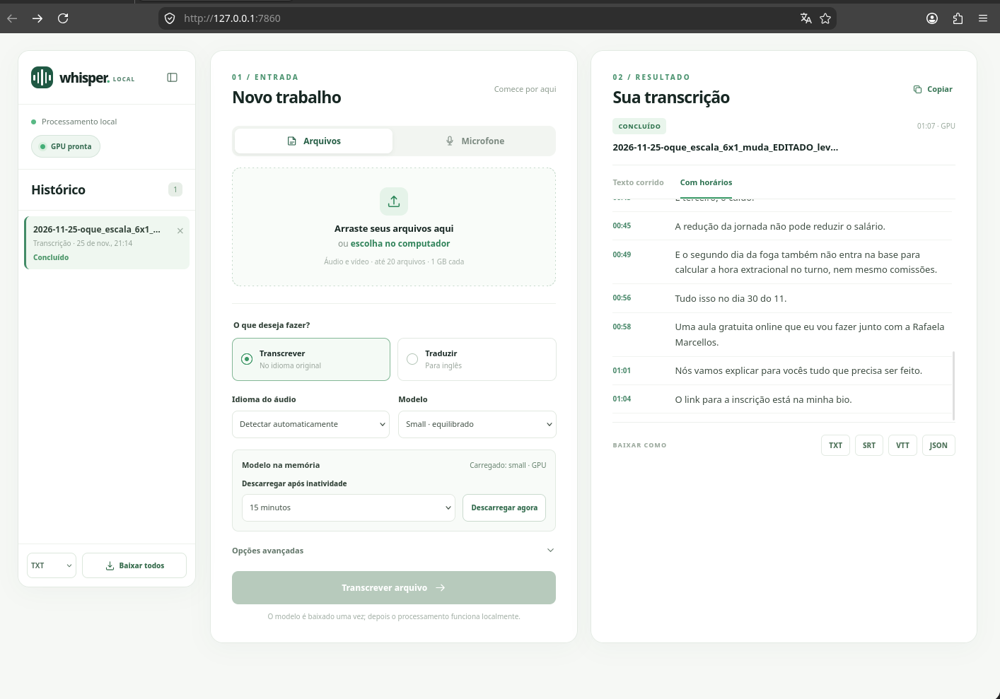

# Whisper Local

A local web interface for transcribing audio and video, recording from a microphone, and translating speech into English with Whisper. Export the transcription or English translation as TXT, SRT, VTT, or JSON. Processing runs on your computer: no OpenAI API or API key is required. Model weights are downloaded from Hugging Face on first use and can then be reused from cache.

I built this to make it easier for my wife to turn videos and audio into text, with the idea of making it available on our local network. Now she can feed it recordings and make my GPU cry—out of love, of course.



**Network access:** the launcher listens on `127.0.0.1` by default. See [Local network access](#local-network-access) for the opt-in setting and its security implications.

## Requirements

- Python 3.10 or newer and a modern browser.
- Linux for `run.sh`; manual setup is available on other platforms.
- Optional: an NVIDIA GPU with a working driver, CUDA 12 cuBLAS, and cuDNN 9.

## Install and run

On Linux, clone the repository, enter its directory, and run:

```bash
./run.sh
```

The script creates `.venv`, installs the required dependencies, and starts the server at [http://127.0.0.1:7860](http://127.0.0.1:7860).

For manual setup:

```bash
python3 -m venv .venv
.venv/bin/python -m pip install -r requirements.txt
.venv/bin/python -m uvicorn whisper_ui.app:app --host 127.0.0.1 --port 7860
```

On Windows, create the virtual environment with `python -m venv .venv`, activate it with `.venv\Scripts\activate`, install dependencies with `python -m pip install -r requirements.txt`, and run `python -m uvicorn whisper_ui.app:app --host 127.0.0.1 --port 7860`.

## Local network access

To listen on all IPv4 interfaces, start the Linux launcher with:

```bash
HOST=0.0.0.0 ./run.sh
```

From another device, open `http://<host-local-ip>:7860` using the computer's LAN IP address. `0.0.0.0` is a listening address, not the address to enter in the browser. Use a firewall to restrict access to trusted devices. A remote browser may require HTTPS for microphone recording; file uploads work over HTTP.

**The app has no authentication.** Anyone who can reach the server can access its API and results or submit jobs. The MCP endpoint can read files accessible to the server process when its host validation permits access. Do not expose the server to untrusted networks or the internet; use appropriate network restrictions and access controls. See [architecture](docs/arquitetura.md).

## Install with an AI assistant

Give an AI coding assistant access to the repository and use this prompt:

```text
Set up and run Whisper Local from this repository. Read the README and any
repository instructions first. Check the installed Python version, create or
repair the virtual environment if needed, and install the dependencies.
If a compatible NVIDIA GPU and driver are available, install the GPU
requirements as documented. Start the app on 127.0.0.1, verify that it
responds, and tell me the URL. Explain any missing system dependencies or
permissions you need. Do not expose the app to the network or download a
Whisper model without asking me first.
```

## Use

1. Add up to 20 audio or video files, or record from your microphone. Each file can be up to 1 GB.
2. Choose transcription or English translation, the input language, and the model. `small` is the default; larger models need more memory.
3. Track jobs in the history. Retry a failed job using its retry icon while the source is available.
4. Copy the transcript or export TXT, SRT, VTT, or JSON. **Download all** creates a ZIP of completed results.

Supported extensions: MP3, MP4, M4A, M4V, WAV, FLAC, OGG, OGA, OPUS, WEBM, MOV, MKV, AVI, AAC, AIFF, WMA, MPEG, and MPGA. Files must contain a decodable audio track. Microphone recording requires browser permission and works on localhost.

The model unloads after 15 minutes of inactivity by default. Change the timeout or unload it manually in **Modelo na memória**. CUDA may retain some VRAM for its context after unloading.

Completed results persist in `data/results/`. Successful uploads are deleted; failed uploads are retained for retry until the job is deleted or the server restarts. Failed jobs do not survive a restart. Local files submitted through MCP are never deleted by the application.

## NVIDIA GPU

Check that `nvidia-smi` works, then install the GPU dependencies:

```bash
.venv/bin/python -m pip install -r requirements-gpu.txt
./run.sh
```

Run `./run.sh` once first if the virtual environment does not exist. The launcher adds the installed cuBLAS and cuDNN library directories to `LD_LIBRARY_PATH`; starting Uvicorn directly does not configure these paths. CUDA is selected automatically when available; otherwise, the app uses CPU. To require CUDA or reduce VRAM use:

```bash
WHISPER_DEVICE=cuda ./run.sh
WHISPER_DEVICE=cuda WHISPER_COMPUTE_TYPE=int8_float16 ./run.sh
```

See the [faster-whisper GPU requirements](https://github.com/SYSTRAN/faster-whisper#gpu) for driver and library details.

## MCP

With the server running, register its local Streamable HTTP endpoint:

```bash
codex mcp add whisper-local --url http://127.0.0.1:7860/mcp
claude mcp add --transport http whisper-local http://127.0.0.1:7860/mcp
```

Use the configured port if it differs from `7860`. The MCP client must run on the same computer and supply an absolute path accessible to the server. The interface and MCP share the queue, model, and history.

Tools: `transcribe_file`, `translate_file`, `get_job`, `wait_for_job`, `read_transcript`, `export_transcript`, `list_jobs`, `get_model_status`, `unload_model`, and `set_model_idle_timeout`. MCP exports are saved in `data/exports/`.

## Configuration

| Variable | Default | Purpose |
| --- | --- | --- |
| `PORT` | `7860` | HTTP port used by `run.sh` |
| `HOST` | `127.0.0.1` | Listening address used by `run.sh`; `0.0.0.0` enables IPv4 network access |
| `WHISPER_DEVICE` | `auto` | `auto`, `cuda`, or `cpu` |
| `WHISPER_COMPUTE_TYPE` | `float16` on GPU, `int8` on CPU | CTranslate2 compute type |
| `WHISPER_DATA_DIR` | `./data` | Temporary files, settings, and results |
| `HF_HOME` | Hugging Face default | Model cache |

## Development

```bash
.venv/bin/python -m pip install -r requirements-dev.txt
.venv/bin/python -m unittest discover -s tests -v
```

See [agent instructions](AGENTS.md), [product requirements](docs/PRD.md), [architecture](docs/arquitetura.md), [tests](docs/testes.md), and [contributing](docs/CONTRIBUTING.md).

## Credits

Built with [faster-whisper](https://github.com/SYSTRAN/faster-whisper), an implementation of [OpenAI Whisper](https://openai.com/index/whisper/). Inspired by [Education-Victory/whisper-webui](https://github.com/Education-Victory/whisper-webui).
