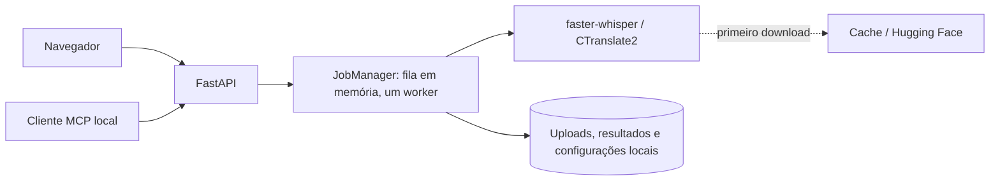

# Arquitetura e limites

Estado observado em 2026-11-25; decisões reconstruídas estão em [ADR 0001](adr/0001-arquitetura-local.md).

`app.py` serve interface e API; `mcp_server.py` usa o mesmo gerenciador; `jobs.py` coordena fila e persistência; `transcription.py` carrega o modelo e formata resultados; `media.py` valida arquivos. `static/` contém a interface. Resultados concluídos são gravados em JSON; fila, erros e trabalhos em andamento não são recuperados após reinício. Uploads remanescentes são removidos na inicialização. Exportações MCP ficam em `data/exports/` e não são removidas automaticamente ao excluir um trabalho.

Uploads de trabalhos que falharam permanecem temporariamente no disco para permitir nova tentativa; são removidos após sucesso, exclusão do trabalho ou reinicialização. Arquivos locais indicados via MCP não são removidos.

Não há autenticação da API/MCP. O launcher usa loopback por padrão, mas `HOST` permite escuta em outras interfaces. Qualquer cliente que consiga acessar a API pode consultar dados e enviar trabalhos; o MCP pode ler arquivos acessíveis ao processo quando sua validação de host permite a conexão. Loopback não isola outros processos locais. A exposição à rede exige restrição externa de acesso e amplia os riscos descritos no [ADR 0002](adr/0002-endereco-de-escuta.md). Resultados e exportações podem conter dados sensíveis; permissões e backup dependem do ambiente.

A fila em memória e o modelo compartilhado pressupõem um único processo de aplicação. Não iniciar múltiplos workers contra a mesma pasta de dados sem redesenhar coordenação, recuperação e escrita concorrente. Falhas abruptas podem deixar temporários; não há garantia transacional entre todas as etapas.
