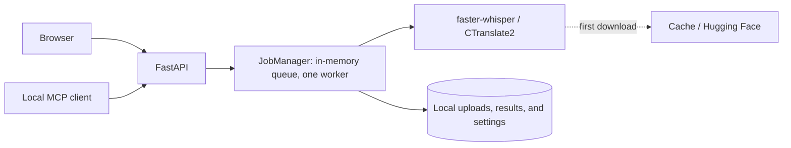

# Architecture and boundaries

State observed on 2026-11-25; reconstructed decisions are in [ADR 0001](adr/0001-arquitetura-local.md).

`app.py` serves the interface and API; `mcp_server.py` uses the same manager; `jobs.py` coordinates the queue and persistence; `transcription.py` loads the model and formats results; `media.py` validates files. `static/` contains the interface. Completed results are stored as JSON; the queue, errors, and in-progress jobs are not recovered after restart. Leftover uploads are removed on startup. MCP exports remain in `data/exports/` and are not automatically removed when a job is deleted.

The local process is the trust boundary: the API/MCP has no authentication. Any client able to access it can submit jobs and, through MCP, request access to files readable by the process. Loopback reduces network exposure but does not isolate other local processes. Do not expose the server to the network without designing authentication, authorization, and abuse protection. Results and exports can contain sensitive data; permissions and backups depend on the environment.

The in-memory queue and shared model assume a single application process. Do not start multiple workers against the same data directory without redesigning coordination, recovery, and concurrent writes. Abrupt failures can leave temporary files; there is no transactional guarantee across all steps.
