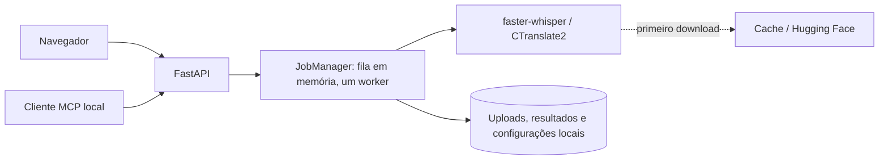

# Arquitetura e limites

Estado observado em 2026-11-25; decisões reconstruídas estão em [ADR 0001](adr/0001-arquitetura-local.md).

`app.py` serve interface e API; `mcp_server.py` usa o mesmo gerenciador; `jobs.py` coordena fila e persistência; `transcription.py` carrega o modelo e formata resultados; `media.py` valida arquivos. `static/` contém a interface. Resultados concluídos são gravados em JSON; fila, erros e trabalhos em andamento não são recuperados após reinício. Uploads remanescentes são removidos na inicialização. Exportações MCP ficam em `data/exports/` e não são removidas automaticamente ao excluir um trabalho.

O processo local é o limite de confiança: não há autenticação da API/MCP. Qualquer cliente que consiga acessá-lo pode enviar trabalhos e, via MCP, pedir leitura de arquivos acessíveis ao processo. Loopback reduz exposição na rede, mas não isola outros processos locais. Não exponha o servidor à rede sem projetar autenticação, autorização e proteção contra abuso. Resultados e exportações podem conter dados sensíveis; permissões e backup dependem do ambiente.

A fila em memória e o modelo compartilhado pressupõem um único processo de aplicação. Não iniciar múltiplos workers contra a mesma pasta de dados sem redesenhar coordenação, recuperação e escrita concorrente. Falhas abruptas podem deixar temporários; não há garantia transacional entre todas as etapas.
